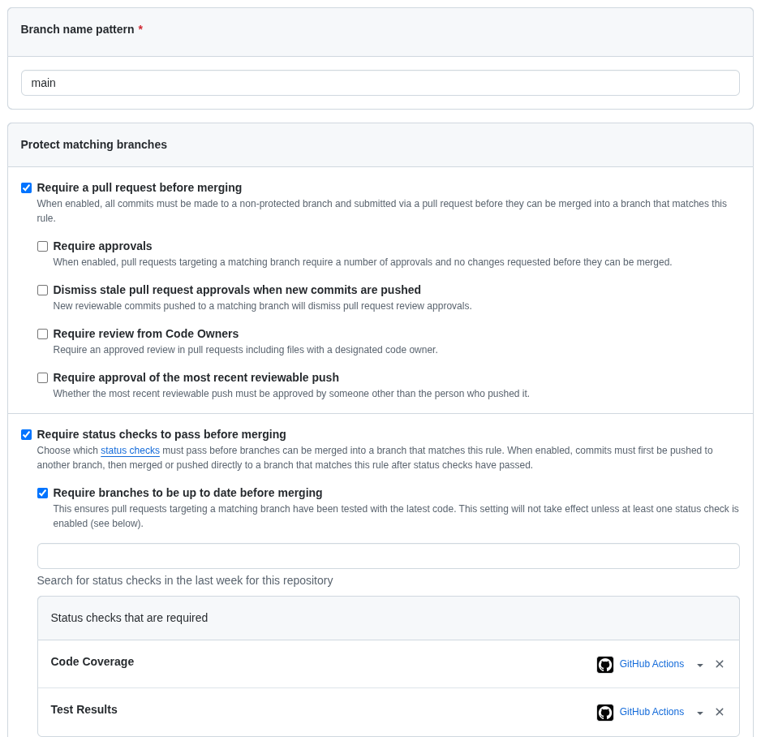
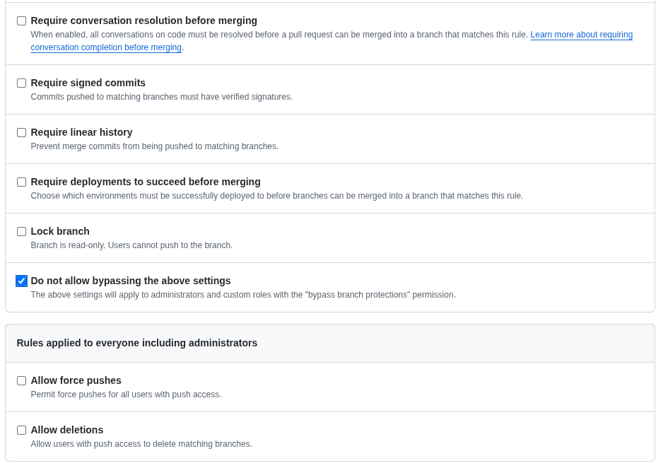
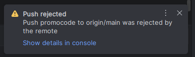
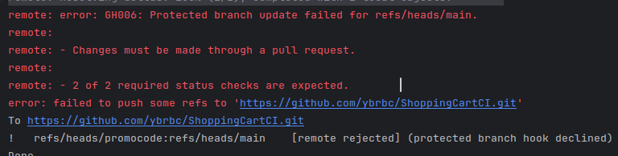
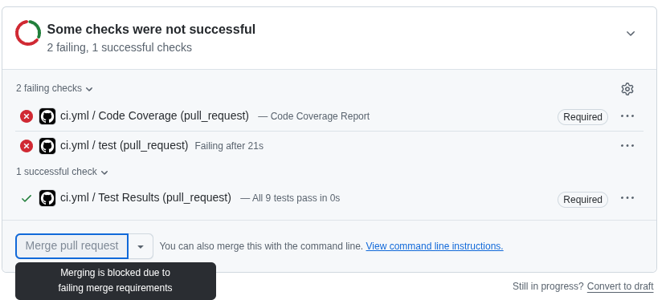

## 1. Какие события активируют пайплайн?

Все события содержащиеся в блоке on в конфигурационных файлах `/.github/workflows/*.yml`. В данном репозитории пайплайн
активируют три типа событий:

- push — автоматический запуск при отправке коммитов в ветки master или main (при условии, что изменения затронули
  файлы, указанные в фильтре paths: src/ **, tests/**, requirements.txt или .github/workflows/**).
- pull_request — автоматический запуск при создании, обновлении или переоткрытии Pull Request, направленного в ветки
  master или main (также при наличии изменений в путях из списка paths).
- workflow_dispatch — ручной запуск пайплайна разработчиком через веб-интерфейс GitHub (во вкладке Actions) или через
  GitHub REST API.

## 2. Будет ли пайплайн с тестами запускаться заново, если разработчик изменил только файл README.md или документацию?

Да, будет если в конфигурации не указано иное.<br>
В данном репозитории запуска не будет, так как в текущей конфигурации [ci.yml](.github/workflows/ci.yml) для событий
push и pull_request настроен фильтр путей paths:

```yaml
paths:
  - 'src/**'
  - 'tests/**'
  - 'requirements.txt'
  - '.github/workflows/**'
```

Поскольку файл README.md и прочая документация не входят в этот перечень, GitHub Actions проигнорирует коммит,
содержащий правки только в документации.

## 3. Как и где в конфигурационном файле GitHub Actions (YAML) вы указываете установку зависимостей для прогона тестов?

Установка зависимостей (python) описана в секции [jobs.test.steps](.github/workflows/ci.yml#45) после
шага [инициализации окружения Python](.github/workflows/ci.yml#40)<br>
В отдельном шаге с помощью ключа `run` вызывается пакетный менеджер `pip`, который считывает список библиотек из
файла [requirements.txt](requirements.txt) в корне репозитория:

```YAML
- run: pip install -r requirements.txt
```

Кэширование зависимостей: В предшествующем шаге `Set up Python` в блоке with: заданы параметры `cache: 'pip'` и
`cache-dependency-path: requirements.txt`. Это указывает GitHub Actions сохранять скачанные пакеты в кэш по хэшу файла
`requirements.txt`, чтобы при следующих запусках не скачивать библиотеки заново.  
Обнаружить работу кэширования можно в логах с помощью поиска `cache hit for`, а отсутствие можно заметить по строке
`pip cache is not found`.

## 4. Настройка запрета на слияние (Merge) коммита, если тесты упали

Чтобы заблокировать слияние Pull Request из ветки в main/master при падении тестов или недостаточном покрытии кода, в
репозитории на GitHub настраиваются правила защиты веток (Branch Protection Rules или Rulesets):

1. Перейдите в репозитории на вкладку **Settings** → **Branches**.
2. Нажмите **Add rule**.
3. В поле **Branch name pattern** укажите имя основной ветки: main (или master).
4. Отметьте пункт **Require a pull request before merging** (запрещает прямой пуш и обязывает вливать изменения через
   Pull Request).
5. Отметьте ключевой пункт **Require status checks to pass before merging** (требовать успешного прохождения проверок
   перед слиянием) и подпункт **Require branches to be up to date before merging**.
6. В появившемся поле поиска статус-чеков добавьте проверки, создаваемые вашим workflow.
7. При необходимости отметьте Do not allow bypassing the above settings (чтобы запрет действовал в том числе и для
   администраторов репозитория) и нажмите Create / Save changes. После этого при падении хотя бы одного теста в pytest
   или снижении покрытия ниже 80% кнопка Merge pull request будет заблокирована.

Настройка текущего репозитория:<br>




Запрет прямого пуша в main:<br>



Запрет слияния до прохождения всех проверок:<br>


## 5. Всегда ли есть необходимость 100%-ого покрытия тестами?

Нет, в промышленной разработке требование 100%-ного покрытия кода тестами оправдано не всегда:

- Где 100% покрытие необходимо: В критически важных бизнес-модулях (расчет стоимости корзины, применение скидок и
  промокодов, финансовые транзакции, биллинг, алгоритмы безопасности), а также в компактных изолированных библиотеках со
  сложной алгоритмической логикой.
- Почему в крупных проектах не стремятся к 100%:
-
    1. Закон убывающей отдачи: Повышение покрытия с 80–85% до 100% требует непропорционально больших затрат времени на
       тестирование тривиального кода (простых геттеров/сеттеров, конфигурационных файлов, точек входа,
       платформозависимых заглушек).
-
    2. Ложное чувство безопасности: 100% покрытие строк (Line Coverage) гарантирует лишь то, что каждая строчка кода
       была исполнена во время тестов, но не гарантирует, что проверены все комбинации входных данных и
       бизнес-требований.
-
    3. Удорожание поддержки: Чрезмерное количество тестов, привязанных к второстепенным деталям реализации, замедляет
       рефакторинг. Поэтому в индустрии оптимальным ориентиром обычно считается порог в 80–90% с обязательным 100%-ным
       покрытием ядра бизнес-логики.

## 6. Какой стек технологий и фреймворк автоматизации используется?

В лабораторной работе задействован следующий технологический стек:

| Категория                              | Используемые технологии и версии                                                                                                                         | Назначение в проекте                                                                                                                                |
|----------------------------------------|----------------------------------------------------------------------------------------------------------------------------------------------------------|-----------------------------------------------------------------------------------------------------------------------------------------------------|
| **Язык программирования**              | **Python 3.13**                                                                                                                                          | Разработка бизнес-логики классов `Product` и `ShoppingCart` (`dataclasses`, типизация).                                                             |
| **Фреймворк тестирования**             | **pytest `9.2.0`** *(вместе с `pluggy 1.7.0`, `iniconfig 2.3.1`, `packaging 26.3`, `Pygments 2.21.0`)*                                                   | Написание и запуск модульных автотестов (фикстуры `@pytest.fixture`, проверка исключений `pytest.raises`), генерация отчета JUnit XML.              | 
| **Анализ покрытия кода**               | **coverage `7.17.0**`                                                                                                                                    | Измерение процента покрытия исходного кода в папке `src/`, контроль порога не ниже 80% (`--fail-under=80`) и генерация Markdown-отчета.             |
| **Платформа CI/CD**                    | **GitHub Actions** (раннер `ubuntu-latest`)                                                                                                              | Автоматизация сборки, установки окружения, запуска тестов и публикации отчетов при каждом `push` и `pull_request`.                                  |
| **Компоненты автоматизации (Actions)** | • `actions/checkout@v7`<br> <br>• `actions/setup-python@v7`<br> <br>• `EnricoMi/publish-unit-test-result-action@v2`<br> <br>• `actions/github-script@v7` | Клонирование репозитория, настройка Python с кэшированием `pip`, визуализация результатов тестов и отправка статуса покрытия через GitHub REST API. |
